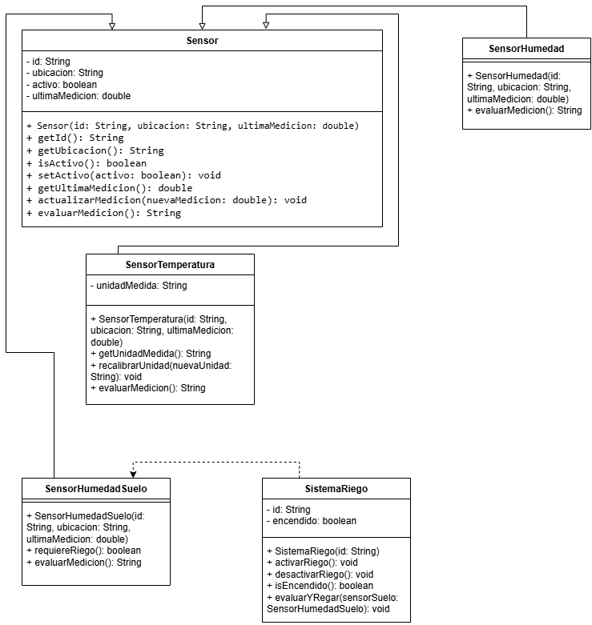

| Clase | Atributos propuestos | Tipo de dato | Métodos propuestos | Responsabilidad |
| :--- | :--- | :--- | :--- | :--- |
| `Sensor` | `id` `ubicacion` `activo` `ultimaMedicion` | `String` `String` `boolean` `double` | `getId()` `getUbicacion()` `isActivo()` `getUltimaMedicion()` `actualizarMedicion(double)` `evaluarMedicion()` | Servir como superclase base para almacenar el estado y comportamiento común de cualquier sensor del invernadero. |
| `SensorTemperatura` | `unidadMedida` | `String` | `getUnidadMedida()` `evaluarMedicion()` `recalibrarUnidad(String)` | Especialización para interpretar la temperatura del aire (°C). |
| `SensorHumedad` | `rangoOptimoMin` `rangoOptimoMax` | `double` `double` | `evaluarMedicion()` | Especialización para evaluar el porcentaje de humedad en el aire. |
| `SensorHumedadSuelo` | `nivelCriticoSecado` | `double` | `evaluarMedicion()` `requiereRiego()` | Especialización para evaluar la humedad de la tierra y determinar la necesidad de riego. |
| `SistemaRiego` | `id` `encendido` `caudalLitrosPorMinuto` | `String` `boolean` `double` | `activarRiego()` `desactivarRiego()` `isEncendido()` `evaluarYRegar(SensorHumedadSuelo)` | Actuador que controla la activación/desactivación del flujo de agua. |

Porque representan de forma modular los componentes fisicos esenciales del sistema de monitoreo y control del invernadero.

El `Sensor` gestiona datos base de medición las subclases interpretan según la variable física `SistemaRiego` ejecuta la acción de riego.

Garantizar el principio de encapsulación y así evitar la modificación directa o inconsistente del estado de los objetos desde clases externas.

Los  datos de identificación inicial (`id`, `ubicación`) configurando limites específicos y la primera medición.

La  super clase se llama `Sensor`.

Las subclases tienen el nombre de:  `SensorTemperatura`, `SensorHumedad`, `SensorHumedadSuelo`.

Proponemos  este porque un `SensorTemperatura` “es un” tipo específico de `Sensor` que comparte operaciones con otros sensores.

Loa atributos y comportamientos son: `id`, `ubicacion`, `activo`, `ultimaMedicion` y los métodos comunes.

La lógica particular de interpretación de `evaluarMedicion()` tendrá  los rangos de tolerancia y métodos específicos como lo es  `recalibrarUnidad()`.

Porque no mide variables, es decir este no es un sensor si no que es un actuador que ejecuta acciones.

Todo el manejo de identificadores y estado de lecturas se abstrajo en la clase base `Sensor`.

No,  los constructores no se heredan almenos no en java.

Orimero se ejecuta el constructor de la superclase y posteriormente el de la subclase.

Se utiliza para delegar a la superclase `Sensor` la inicialización de los atributos comunes (`id`, `ubicacion`, `ultimaMedicion`).

Sobreescribi el método `evaluarMedicion()`.

Nos indica que el compilador que se esta reemplazando la implementación de un método de la superclase.

Porque nos permite invocar la misma operación en cualquier tipo de sensor de una manera uniforme.

Este metodo nos permite aplicar el polimorfismo haciendo que el código maestro trate a todos los objetos bajo el tipo común `Sensor`.

| Tipo de referencia | Tipo real del objeto  | Método que se ejecuta |
| :--- |:----------------------| :--- |
| `Sensor` | `SensorTemperatura`   | `SensorTemperatura.evaluarMedicion()` |
| `Sensor` | `SensorHumedad`       | `SensorHumedad.evaluarMedicion()` |
| `Sensor` | `SensorHumedadSuelo`  | `SensorHumedadSuelo.evaluarMedicion()` |

Porque existe una relación de herencia entre `SensorTemperatura` y `Sensor`.

No lo puede hace directo ya que requiere un casting para hacer una comprobación porque no todo `Sensor` es de temperatura.

Se ejecuta la versión correspondiente al  objeto instanciado en el tiempo de ejecución.

Lo hace mediante un enlace dinámico, consultando la tabla de métodos virtuales del objeto en tiempo real.

Se puede observar en el bucle (for) porue este produce comportamientos distintos segun sea el objeto.

Lo podemos observar en el momento que se ejecuta el programa.

El casting fue necesario porque la referencia `Sensor` no da acceso a métodos específicos definidos solamente en las subclases.

Nos ayuda a verificar si el objeto referenciado es una instancia real  o de sus subclases.

sucede una excepción en el tiempo de ejecución `ClassCastException`.

Pues basicamente porque nos acopla el código a tipos concretos y rompe la extensibilidad ademas de que viola el principio .

Porque la referencia del `Sensor` no posee los métodos específicos en las subclases.

Nos ayuda a verifica el tiempo en que se ejecuta y si el objeto apuntado esta en una instancia real de una clase determinada.

El programa interrumpirá la ejecución.

Porque nos obligaría a escribir cadenas de if/else cada vez que se agregue una nueva subclaseteniendo que hacer mas trabajo y perdiendo la simplicidad del polimorfismo.

El `SistemaRiego` no se considera como sensor pero se utiliza información de `SensorHumedadSuelo`-

